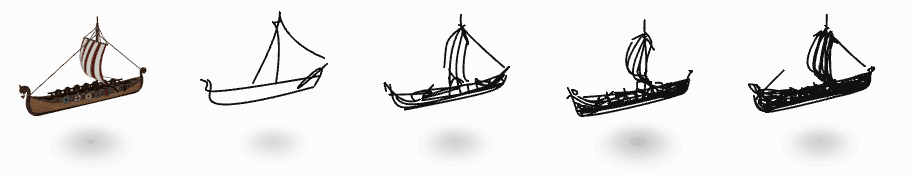

# From Pixels to Wireframes: 3D Sketches via CLIP-Based Abstraction

<p align="center"></p>

A small set of 3D cubic Bézier curves is optimized so that, seen from any camera, it looks like the object
to CLIP. Each curve is rendered as a chain of spherical Gaussians, so the renderings are differentiable with
respect to the control points, and the loss is CLIPasso's balance of a geometric and a semantic CLIP term.
The number of lines and that balance span everything from faithful wireframes to loose, abstract sketches.

**Project page:** <https://tarhanefe.github.io/CLIPasso3DWebsite/> (interactive results on 20 Objaverse objects).

## Setup

```bash
git clone https://github.com/tarhanefe/clipasso3d.git && cd clipasso3d
conda create -n clipasso3d python=3.10 -y && conda activate clipasso3d
pip install torch torchvision --index-url https://download.pytorch.org/whl/cu121   # match your CUDA
pip install -r requirements.txt
```

Rendering training data needs [Blender](https://www.blender.org/download/) ≥ 3.6 (headless is fine).

## 1. Data: mesh → multi-view images

```bash
# the project's 20 Objaverse objects (ids and attribution in meshes/objaverse_selection.json)
python tools/fetch_objaverse.py --out meshes/objaverse --selection meshes/objaverse_selection.json
# render every mesh: 100 train / 30 val / 30 test views, transparent background (resumable)
tools/render_all.sh meshes/objaverse data/objaverse
```

Any `.glb/.gltf/.obj/.fbx/.ply/.stl` works; one mesh: `blender -b -P tools/render_mesh.py -- --mesh my.glb --out data/my`.
Each scene is normalized to the unit sphere and written as `data/<name>/{transforms_*.json, rgb/, surface_points.npy}`
(NeRF/Blender camera convention).

## 2. Train

```bash
python run.py --data_name objaverse/boat --n_curves 20
```

| Option | Default | |
|---|---|---|
| `--n_curves` | 25 | number of lines |
| `--geometric_weight` / `--semantic_weight` | 1 / 0.1 | CLIPasso loss balance; a higher semantic share gives more abstract sketches |
| `--thickness` | 0.008 | stroke radius (Gaussian σ, object fits the unit sphere) |
| `--batch_size` / `--epochs` | 8 / 150 | views per step / passes over the training views |
| `--early_stop_patience` | 0 (off) | stop once the validation loss is flat for this many validations |
| `--prune_every`, `--prune_start`, `--prune_stop` | off, 0, 2450 | move lines that left the object back onto it (line count fixed) |
| `--connect_weight`, `--weld` | 0, off | connectivity loss and final weld: one physically connected piece |
| `--wandb` | off | log to Weights & Biases |

Curves start as short lines spread over the visual hull of the training masks. `python run.py --help` lists
every option. A run writes to `runs/<data_name>/<run_name>/`:

- `curves.pt` (final control points) and `curves_history.npz` (snapshots during training)
- `metrics.json` on the test views: CLIP similarity, ink on the object, Chamfer distance to the surface
- `semihelical.gif` (fly-around) and `training_evolution.gif`

Runs checkpoint as they go: the same command resumes a stopped run and skips a finished one.

## 3. Experiments

```bash
experiments/ablation.sh        # 20 objects × {5,10,20,50,100,200} lines × 5 abstraction levels
experiments/connectivity.sh    # no constraint / weld only / connectivity loss 0.1 and 1.0, at 5–200 lines
# one worker per GPU, on any number of machines sharing the folder (restart-safe):
CUDA_VISIBLE_DEVICES=0 python tools/sweep.py run --jobs jobs/ablation/all.jsonl --worker 0 --nworkers 4
python tools/status.py jobs/ablation/all.jsonl     # done / total, running, failed, ETA
```

## 4. Figures and project page

```bash
blender -b -P tools/render_turntable.py -- --mesh meshes/objaverse/boat.glb --out turntables/boat
python tools/make_grid_gif.py --object boat --turntable turntables/boat --out figures/boat_grid.gif   # lines × abstraction
python tools/export_web.py runs --out ../CLIPasso3DWebsite/static/data                                 # interactive grids
blender -b -P tools/export_gt_glb.py -- --mesh meshes/objaverse/boat.glb --out ../CLIPasso3DWebsite/static/data/gt/boat.glb
```

## Code

| | |
|---|---|
| `run.py`, `source/pipeline.py` | options, training run, metrics and outputs |
| `source/beziercurve.py`, `source/diffrasterizer.py` | Bézier curves → Gaussians → differentiable splatting |
| `source/cliploss.py`, `source/metrics.py` | CLIPasso loss; evaluation |
| `source/trainer.py`, `source/initalizer.py`, `source/pruning.py` | training loop, visual-hull initialization, respawning |
| `source/connectivity.py` | connectivity loss and weld |
| `tools/` | data download and rendering, sweeps, figures, website export |

3D models from [Objaverse](https://objaverse.allenai.org/), CC-BY/CC0; authors are listed in
`meshes/objaverse_selection.json`. Developed for EPFL CS-503 *Visual Intelligence: Machines and Minds*.
